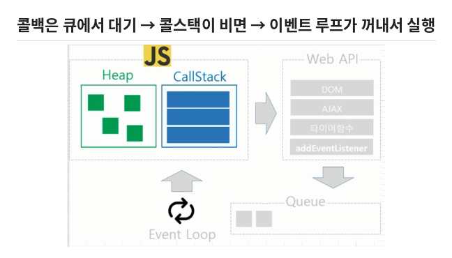

# 📒 msa5-js

> MSA 기반 자바 풀스택 과정 — **JavaScript 수업 기록**
> 배운 내용을 직접 코드로 따라 치면서 정리하는 저장소예요.

<br>

## 📂 목차

| 파일 | 주제 | 핵심 키워드 |
|---|---|---|
| [`13_exception.js`](./edu/13_exception.js) | 예외처리 | `try` · `catch` · `finally` · `throw` · `instanceof` |
| [`14_destructuring.js`](./edu/14_destructuring.js) | 구조분해 문법 | 배열/객체 구조분해 · 이름 바꾸기 · 기본값 |
| [`17_timer.js`](./edu/17_timer.js) | 타이머 함수 & 비동기 | `setTimeout` · `setInterval` · `clear~` |
| [`18_ajax`](./edu/18_ajax.html) | AJAX 시작 | `axios` · `form` · `e.preventDefault()` · `e.target` |
| [`19_promise.js`](./edu/19_promise.js) | Promise | 콜백 지옥 · `resolve` / `reject` · `.then` · `.catch` · `.finally` |
| [`20_async_await.js`](./edu/20_async_await.js) | async / await | `async` · `await` · `try` / `catch` |

<br>

## 🔄 이벤트 루프



- **Heap** : 객체, 배열 같은 데이터를 저장하는 공간
- **Call Stack** : 지금 실행 중인 함수를 쌓아두는 곳 (JS는 딱 하나!)
- **Web API** : 타이머, AJAX, 이벤트처럼 기다려야 하는 일을 대신 처리
- **Queue** : 일이 끝난 콜백이 줄 서서 대기하는 곳
- **Event Loop** : 콜스택이 비면 큐에서 콜백을 꺼내 실행

<br>

## ✏️ 오늘의 한 줄 정리

**예외처리**
> 에러가 나는 순간 `try`의 남은 줄은 건너뛰고 `catch`로 점프!
> `finally`는 에러가 나든 안 나든 무조건 실행.

**구조분해**
> 배열은 **순서**대로, 객체는 **키 이름**으로 꺼낸다.
> `:` 는 이름 바꾸기, `=` 는 기본값.

**타이머 & 비동기**
> `setTimeout`은 시간이 0이어도 **일단 뒤로 보낸다.**
> 동기 코드가 다 끝난 뒤에 실행됨.

```js
console.log("A");
setTimeout(() => console.log("B"), 0);
console.log("C");
// 결과: A → C → B
```

**Promise**
> "결과는 나중에 알려줄게"라는 약속. 성공하면 `resolve`, 실패하면 `reject`.
> 콜백 안에 콜백이 계속 파고드는 **콜백 지옥**을 피하려고 생겼다.

**async / await**
> `async`는 **함수 앞**, `await`는 **기다릴 것 앞**.
> `await`는 **자기 함수만** 멈추고, 바깥 코드는 계속 진행한다.

**받는 방법은 두 가지 — 섞지 않기!**

| 방식 ① Promise 체이닝 | 방식 ② async / await |
|---|---|
| `.then` 으로 성공 받기 | `await` 로 기다리기 |
| `.catch` 로 실패 받기 | `try { } catch { }` 로 실패 받기 |
| 점(`.`)으로 줄줄이 이어 붙임 | 중괄호 블록, 위에서 아래로 읽힘 |

```js
// 방식 ①
timer("a")
  .then((result) => console.log(result))
  .catch((error) => console.log(error.message))
  .finally(() => console.log("끝"));   // finally는 항상 실행

// 방식 ②
const run = async () => {
  try {
    const result = await timer("a");
    console.log(result);
  } catch (error) {
    console.log(error.message);
  }
};
```

**`catch` vs `.catch`**
> `try`의 `catch`는 **문법(키워드)**, `.catch`는 Promise가 가진 **함수**.
> 하는 일(에러 처리)은 같지만, 점(`.`)이 붙으면 Promise 쪽이다.
> try-catch만으로는 나중에 터지는 비동기 에러를 못 잡는다 → `.catch` 또는 `await` + try-catch 사용.

**AJAX**
> 페이지 새로고침 없이 서버에서 데이터만 받아오는 것.
> 폼 전송 시 `e.preventDefault()`로 새로고침을 막고, `e.target.이름.value`로 입력값을 꺼낸다.

<br>

## 🗓️ 다음에 배울 것

- [x] Promise
- [x] async / await
- [ ] AJAX — axios로 서버에 요청 보내고 카드 채우기
